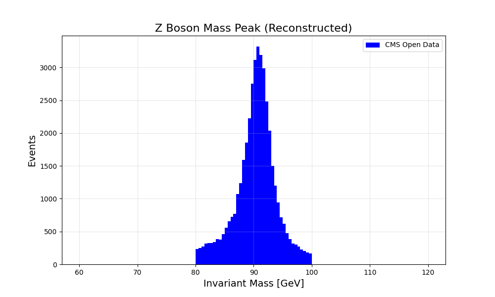

# CMS Open Data Analysis: Z-Boson & Type-III Seesaw Search

This repository contains a Python-based data analysis pipeline using the CMS DoubleMu open dataset to reconstruct Standard Model particles and replicate an elementary search for beyond-the-standard-model (BSM) physics.
The dataset I used was taken from the "CERN Open Data Portal" (https://opendata.cern.ch/)

## Analysis Workflow
* **1)Baseline:** Reconstructed the Standard Model Z-boson mass peak at $\approx 91$ GeV to validate the event-cleaning and vector addition logic. Filtered for events with $\ge 2$ muons, required opposite charges, and restricted the invariant mass to a 60-120 GeV window to suppress low-mass resonances and noise.
* **2)Heavy Fermion Search:** Hunted for heavy Type-III Seesaw fermions ($\Sigma$) targeting the $\Sigma \rightarrow Z\mu \rightarrow 3\mu$ decay chain. 
* **3)Kinematic Cuts:** Filtered for rare events with $\ge 3$ muons and applied strict physical charge consistency. Implemented a scalar sum of transverse momenta cut of $L_T > 500$ GeV to eliminate soft backgrounds, and identified Z-boson candidates by requiring the lower-energy muons to fall within an 80-100 GeV mass window.
* **4)Results:** Reduced the dataset to 169 final candidates in the high-mass region.

## Z-Boson Resonance Reconstruction

## Technical Competencies
* **1)Columnar Data Processing:** Utilized `uproot` to read ROOT files directly into Python and `awkward` arrays to efficiently manipulate non-rectangular (jagged) physics event data natively, avoiding computationally expensive loops.
* **2)Kinematics:** Computed invariant masses, and transverse momenta using the `vector` library for 4-momentum Lorentz kinematics.
* **3)Visualization:** Generated kinematic distributions and resonance plots using `matplotlib` and `numpy`.
